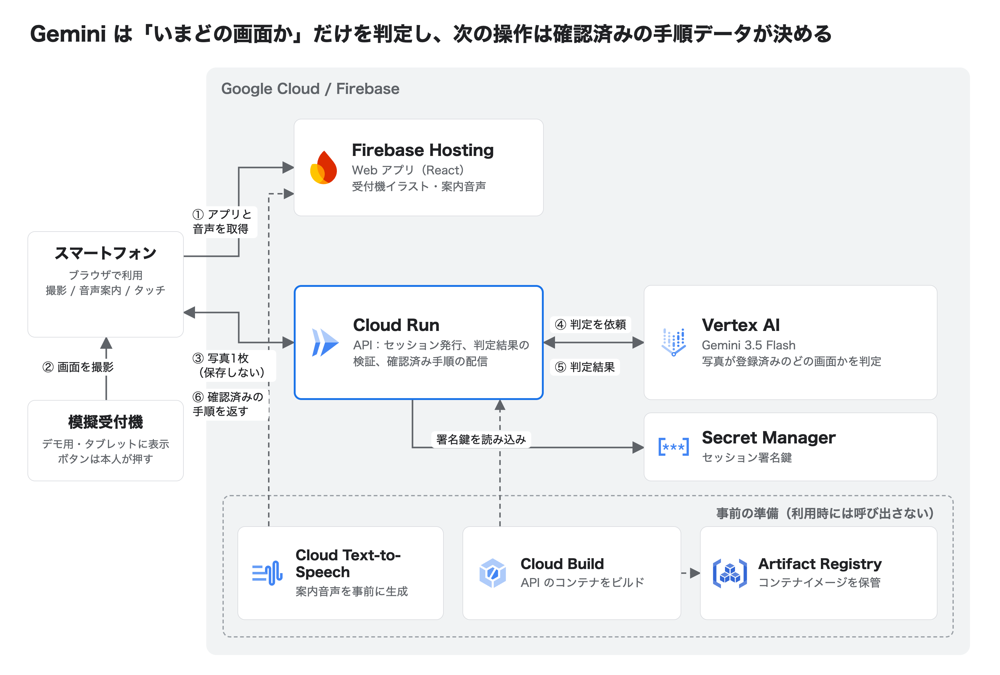
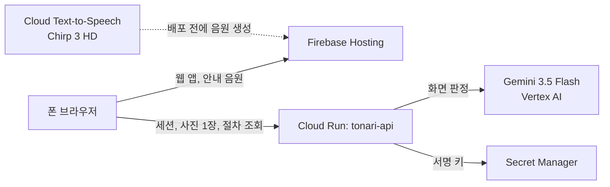

# 현재 아키텍처

핵심은 역할 분리다. **Gemini는 "지금 어느 등록 화면인가"만 판정하고, 다음에 무엇을 누를지는 사람이 검수한 절차 데이터(`flows/`)가 정한다.** 모델 답은 등록 화면 ID, `sensitive`, `unsupported`, `unknown` 중 하나로만 나간다.

## 웹 (`apps/web`)

React/TypeScript/Vite와 Zod 절차 엔진을 사용한다.

- App: 라우트와 요청 조율. 요청 ID/AbortController로 취소한 요청의 결과를 버린다.
- reducer: 시작/촬영/식별/안내/직원, 임시 선택과 선택 확정, 안전 멈춤, 복귀 지점, 한 단계 되돌리기(`trail`), 안내 불가 이유, 화면 revision 관리.
- shared: Flow/Identify 런타임 스키마, 참조·중복 ID·기기/버전/첫 단계 관계 검증. 서버와 웹이 함께 쓴다.
- hospital-scenes: 등록된 그림과 목표 위치. 현 버전의 안전 단계/분기 그래프를 고정 검증.
- useCamera: 후면 카메라, JPEG 생성(긴 변1280px,품질.85,임시2MiB 한도), 취소·숨김·연결 해제·늦은 허용 정리. 마이크 없음.
- useGuidanceAudio: 단계에 들어가면 안내를 한 번 자동 재생한다. Cloud TTS로 미리 만든 음원을 쓰고, 없거나 실패하면 기기 내 일본어 음성으로 대체한다. 자동 읽기는 끌 수 있다.
- useScreenWake: 촬영부터 안내 종료까지 화면 꺼짐을 막는다. 지원하지 않으면 그대로 진행한다.
- 뒤로 가기: 안내 중에는 한 단계 되돌리고, 첫 단계에서는 촬영 화면으로 돌아간다.
- HTTP gateway: session/identify/flows 클라이언트. 토큰/사진은 메모리, POST 자동 재시도 없음.
- /demo: 외부 API 없이 검수 fixture로 동작. AI를 쓰지 않는다.
- /mock/hospital: 실제로 눌러 진행하는 모의 접수기. 폰과 원격 동기화하지 않는다.

## API (`apps/api`)

Hono + Node.js. 설정은 전부 환경 변수다.

- `POST /session`: HS256 JWT, 30분.
- `POST /identify`: JPEG 한 장(최대 2MiB)을 Gemini로 판정한다. 사고 수준 LOW, 이미지 해상도 MEDIUM을 쓰고, 6초 안에 답이 없거나 일시 오류면 두 번째 요청을 보낸다. 사진에서 「デモ用の模擬端末」가 읽혀야 등록 화면으로 판정한다. 나가기 전에 strict 스키마와 검수된 flow로 다시 검증하고, 맞지 않으면 `unknown`을 돌려준다.
- `GET /flows/:id?version=`: `reviewed: true`인 절차만 돌려준다.
- 기록은 경로·상태·소요 시간만 남긴다. 사진과 토큰은 저장하거나 기록하지 않는다.
- 분당/총량 제한(429), 긴급 정지(503), CORS 허용 목록.

배포 구성과 운영 명령은 [backend-handoff](backend-handoff.md)에 있다. 실제 폰 사진의 식별 정확도는 아직 측정하지 않았다.
